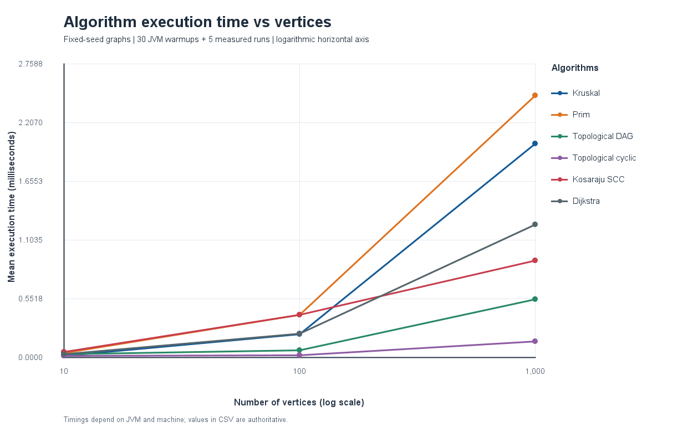
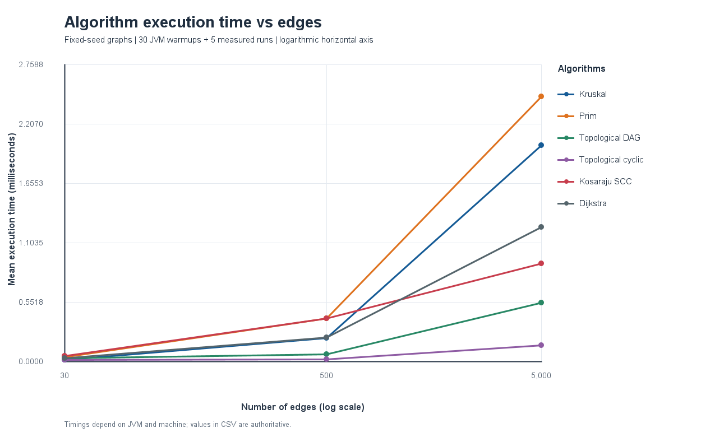

# Assignment 3 — Smart City Infrastructure and Route Planning

This is my Java project for Assignment 3. The idea is to represent a city as a graph and use graph algorithms to solve common city planning problems, such as connecting districts at the lowest cost, checking whether locations are connected, and finding the shortest route between them.

I used **Java 17+** and standard Java libraries, so there is no need to install any extra dependencies.

## What the project does

Each district is a **vertex**, each road is an **edge**, and the edge's weight represents either the cost of building a road or the distance between locations. The project supports both two-way roads (undirected graphs) and one-way roads (directed graphs).

I implemented these algorithms:

- **Kruskal:** chooses a low-cost set of roads connecting all districts.
- **Prim:** solves the same problem using a different approach.
- **Disjoint Set Union (DSU):** keeps track of which districts are connected. It is used by Kruskal.
- **Topological sort (Kahn's algorithm):** finds a valid order for tasks with dependencies, or reports a cycle.
- **Strongly Connected Components (Kosaraju):** finds groups of locations that can all reach one another by following one-way roads.
- **Dijkstra:** finds shortest distances and actual routes from a starting district.

## How to run

Install **JDK 17 or newer**, then open the project folder in IntelliJ IDEA or a terminal.

On **Windows**, run:

```bat
run.bat demo
run.bat test
run.bat benchmark
```

On **Linux or macOS**, run:

```bash
./run.sh demo
./run.sh test
./run.sh benchmark
```

The `demo` command shows an example city, `test` checks the algorithms, and `benchmark` runs the performance experiments and saves the results. Running `run.bat` or `./run.sh` without an argument runs the tests and benchmarks. Run these commands from the project folder.

## How I implemented the algorithms

### Minimum spanning tree — Kruskal and Prim

A minimum spanning tree (MST) connects all districts in a connected undirected graph while keeping the total construction cost as low as possible.

**Kruskal** sorts roads by cost and adds the cheapest road that does not create a cycle. It uses **DSU** to check whether two districts are already connected. My DSU uses *path compression* and *union by size*, which make repeated connection checks faster.

**Prim** starts from a district and grows the network by choosing the cheapest road to an unvisited district. I used Java's `PriorityQueue` to pick roads efficiently.

Both algorithms return the total cost and selected roads. They also detect disconnected graphs. In that case, they return a minimum spanning forest instead of claiming the whole city is connected. For connected graphs, both should return the same total cost, although they might pick different roads when multiple MSTs are possible.

### Topological sort

Topological sorting is useful when one task must happen before another. For example, a service might need electricity before it can operate.

I used **Kahn's algorithm**, which starts with vertices that have no incoming dependencies. If it cannot process every vertex, there is a directed cycle and no valid topological order exists.

### Strongly connected components

A strongly connected component (SCC) is a group of locations where each location can reach every other location in the same group by following directed roads.

I used **Kosaraju's algorithm**. It visits the graph, reverses the direction of its edges, and then finds the groups using a second traversal. The implementation uses iterative DFS to avoid deep recursion.

### Dijkstra's shortest path

Dijkstra finds the shortest route from one starting district to every reachable district. It uses a priority queue to process the nearest candidate, and it remembers previous vertices so it can print the full route, not just the distance.

If a district cannot be reached, the program reports that. Edge weights must be **non-negative**. Dijkstra is not the right choice for negative weights because a route that seemed shortest could become shorter after passing through a negative-weight edge. Bellman–Ford is a better choice when negative weights are needed.

## Time and space complexity

Here, **V** means the number of vertices (districts), **E** means the number of edges (roads), and `α(V)` is a function that grows extremely slowly.

- **DSU:** Creating it takes `O(V)` time and space. With path compression and union by size, `find` and `union` take about `O(α(V))` amortized time, which is practically constant for these graph sizes.
- **Kruskal:** `O(E log E + E α(V))` time, mostly because the roads must be sorted. It uses `O(V + E)` extra space.
- **Prim:** `O((V + E) log(E + 1))` time and `O(V + E)` extra space with an adjacency list and edge priority queue.
- **Topological sort:** `O(V + E)` time and `O(V)` extra space because it processes each vertex and edge a limited number of times.
- **Kosaraju SCC:** `O(V + E)` time and `O(V + E)` extra space, including the reversed graph.
- **Dijkstra:** `O((V + E) log(V + E))` time and `O(V + E)` extra space with a priority queue that can contain repeated entries.

The original graph itself also needs `O(V + E)` memory because it is stored as **adjacency lists**. In general, larger graphs require more work. Kruskal spends extra time sorting edges; Prim and Dijkstra spend time managing priority queues; topological sort and Kosaraju mainly visit vertices and edges.

## Experiments

I tested three graph sizes, as required:

- **Small:** 10 vertices and 30 edges.
- **Medium:** 100 vertices and 500 edges.
- **Large:** 1,000 vertices and 5,000 edges.

The graphs are generated using a **fixed random seed**, so the same inputs can be created again. For MST, the undirected generator first connects all vertices, then adds more roads without repeating edges. The directed DAG generator only creates edges going forward in a shuffled vertex order, so there are no cycles. The directed cyclic generator creates three internally connected groups, each with directed cycles, and adds extra edges within groups or from earlier groups to later groups. This means those graphs have **three SCCs**.

Each graph is created before the timer starts. I run each algorithm **30 times as a warm-up**, then measure **five runs** using `System.nanoTime()` and calculate their average. The program also counts operations such as edge checks, heap activity and DSU operations. These counts help explain the workload, but they are not the same as CPU instructions.

## Results

The complete measured results are in [benchmark_results.csv](results/tables/benchmark_results.csv). They were recorded on one Java runtime and will vary somewhat from computer to computer.

Here are the main results from the initial run:

- **Small graph:** Kruskal took **0.009 ms**, Prim **0.028 ms**, Kosaraju **0.038 ms**, and Dijkstra **0.022 ms** on average.
- **Medium graph:** Kruskal took **0.193 ms**, Prim **0.246 ms**, Kosaraju **0.224 ms**, and Dijkstra **0.296 ms**.
- **Large graph:** Kruskal took **1.042 ms**, Prim **1.053 ms**, Kosaraju **1.073 ms**, and Dijkstra **0.280 ms**.

Kruskal and Prim returned the **same MST costs**: 244 for the small graph, 1,432 for the medium graph, and 12,711 for the large graph. This is one of the important correctness checks.

For the large graph, Kruskal counted **72,344** recorded operations and Prim **131,628**. These counts are not directly comparable because the algorithms count different kinds of work. Dijkstra's recorded operations increased from **143** to **2,427** to **28,849** as graph size increased. Kosaraju's counts also increased steadily (**150**, **2,100**, **21,000**), which fits its linear-time complexity.

The topological sort produced valid orders for all generated DAGs and correctly reported cycles for the cyclic graphs. The SCC algorithm found three groups for each generated cyclic graph, as expected.

### Execution time vs. number of vertices



### Execution time vs. number of edges



Both graphs use the same three datasets, so the number of vertices and edges increases together. The plots show how performance changes as the overall graph gets larger; they do not separately prove whether vertices or edges caused the change.

## What I learned from the comparison

**Kruskal vs. Prim:** Both are correct for finding a minimum spanning tree. Kruskal was a little faster in this particular experiment, while the large-graph times were very close. Kruskal works naturally with a list of edges; Prim works naturally with an adjacency list. The best choice depends on the graph and how it is stored.

**DSU:** Path compression shortens the route to a component's representative, and union by size avoids creating unnecessarily tall trees. Together, they make Kruskal's repeated checks efficient.

**SCC:** Kosaraju's work increased with graph size, which is what we expect from `O(V + E)`. The test graphs always had three SCCs because of how they were generated.

**Topological sort:** It worked for DAGs and rejected cyclic graphs. Some cyclic cases completed faster because they had no vertex with zero incoming edges, so the algorithm could stop early.

**Dijkstra:** More vertices and edges generally mean more work. Its measured time was slightly lower on the large graph than on the medium graph in this run, even though it counted more operations. That is a reminder that very short timing measurements can change because of JVM behavior and background system activity.

Overall, the operation counts followed the expected trends more consistently than the very small measured times. Five runs are enough for this assignment, but more runs would give more reliable timing comparisons.

## Testing

I ran the test suite, and **all 17 test groups passed**. The saved output is in [test_results.txt](results/tables/test_results.txt).

The tests cover small graphs, disconnected graphs, directed cycles, duplicate edge weights, several equally good MSTs, unreachable locations, single-vertex graphs, invalid inputs, and fixed-seed graph generation. They also check that:

- Kruskal and Prim agree on MST cost for connected graphs.
- Topological orders follow all the graph's dependencies.
- Cyclic graphs are rejected by topological sorting.
- Every vertex belongs to exactly one SCC.
- Dijkstra returns the right distances and paths.

There is also a GitHub Actions workflow that runs the Java tests when changes are pushed to GitHub.

## Example demo

Run `run.bat demo` on Windows or `./run.sh demo` on Linux/macOS. The example includes **Central, University, Hospital, Station, Park and Airport**.

In that example, Kruskal and Prim both find an infrastructure cost of **15**. Dijkstra finds a route from Central to Hospital through University with distance **6**, and a route to Airport with distance **16**. The demo also prints dependency ordering and strongly connected groups.

## Conclusion

This project helped me understand that different graph algorithms answer different questions. Kruskal and Prim are useful for building a low-cost network. Topological sorting helps order dependent tasks. Kosaraju finds locations that are mutually reachable on one-way roads. Dijkstra is useful for route planning when distances are non-negative.

The algorithms passed the correctness tests, and the experiments show how their workload changes with graph size. In practice, choosing an algorithm depends on the problem, the type of graph, and how its data is represented.

## GitHub submission

Create an empty GitHub repository and push this project to it. If your local copy already has Git history, you can run the following from the project folder (replace `YOUR_USERNAME`):

```bash
git remote add origin https://github.com/YOUR_USERNAME/assignment-3.git
git branch -M main
git push -u origin main
```

Submit the link to **your** repository. Do not upload the generated `out/` folder; `.gitignore` excludes it.
